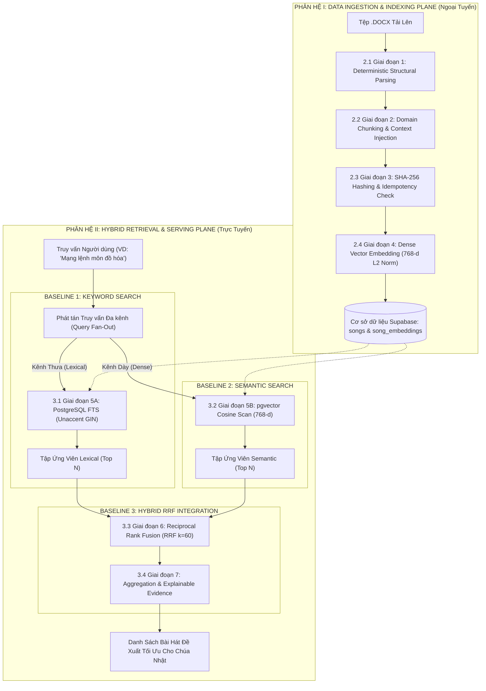
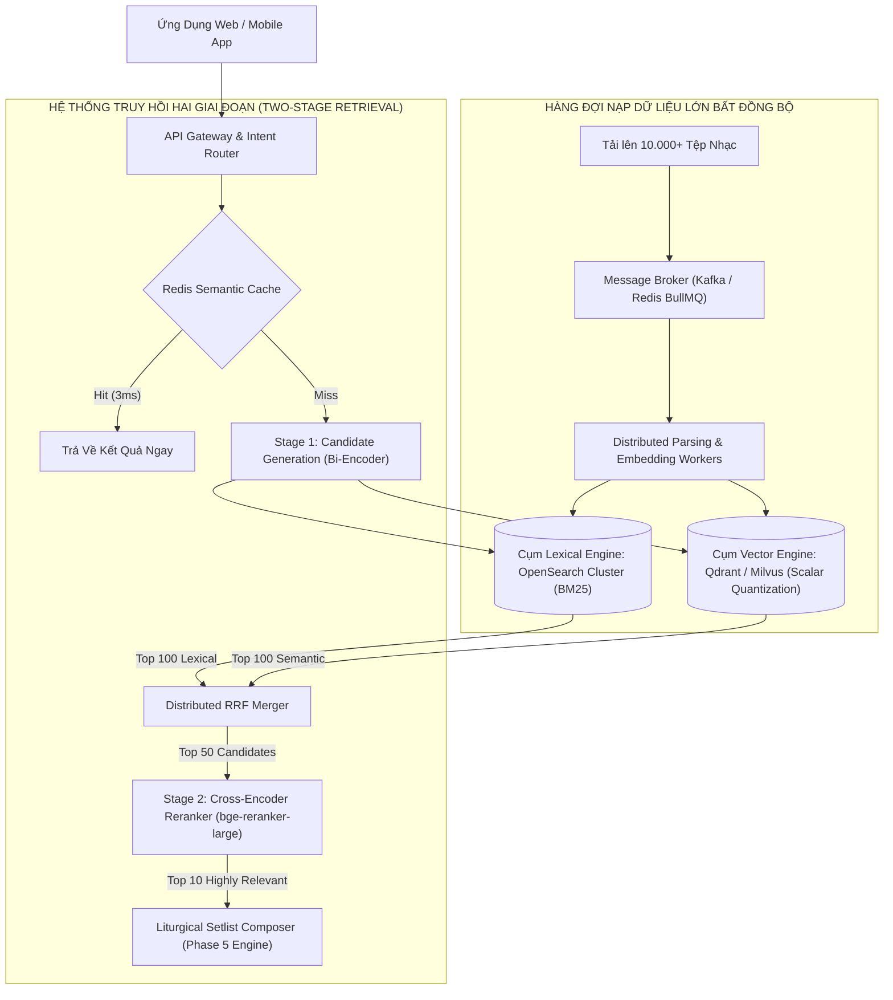

# CẨM NANG KỸ THUẬT CHUYÊN SÂU: HỆ THỐNG TRUY HỒI THÔNG TIN LAI GHÉP & CHIẾN LƯỢC MỞ RỘNG
## End-to-End Hybrid Information Retrieval Pipeline: Dissection, Trade-offs & Scalability

> **Tài liệu**: Nghiên cứu Kiến trúc Kỹ thuật Chi tiết Từng Thành phần, Lý do Lựa chọn & Giải pháp Mở rộng  
> **Dự án**: Website Ban Thờ Phượng (Worship Team System)  
> **Tác giả**: Antigravity (Google DeepMind Advanced Agentic Coding) & Lead Architect  
> **Phiên bản**: 3.0 (Component-by-Component Dissection Spec) — Tháng 10/2026  

---

## MỤC LỤC TỔNG QUAN

1. [Sơ đồ Kiến trúc Pipeline Toàn trình (End-to-End Pipeline Overview)](#1-sơ-đồ-kiến-trúc-pipeline-toàn-trình)
2. [PHÂN HỆ I: DATA INGESTION & INDEXING PLANE (Mặt Phẳng Dữ Liệu Ngoại Tuyến)](#2-phân-hệ-i-data-ingestion--indexing-plane)
   - 2.1 [Giai đoạn 1: Bóc tách Cấu trúc Tài liệu (Deterministic Document Parsing)](#21-giai-đoạn-1-bóc-tách-cấu-trúc-tài-liệu-deterministic-document-parsing)
   - 2.2 [Giai đoạn 2: Phân mảnh Ngữ nghĩa & Tiêm Ngữ cảnh (Domain Chunking & Context Injection)](#22-giai-đoạn-2-phân-mảnh-ngữ-nghĩa--tiêm-ngữ-cảnh-domain-chunking--context-injection)
   - 2.3 [Giai đoạn 3: Băm Mật mã & Chống Trùng lặp (Cryptographic Hashing & Idempotency)](#23-giai-đoạn-3-băm-mật-mã--chống-trùng-lặp-cryptographic-hashing--idempotency)
   - 2.4 [Giai đoạn 4: Nhúng Vector Đa chiều & Lưu trữ Vector (Dense Vector Embedding & Storage)](#24-giai-đoạn-4-nhúng-vector-đa-chiều--lưu-trữ-vector-dense-vector-embedding--storage)
3. [PHÂN HỆ II: HYBRID RETRIEVAL & SERVING PLANE (Mặt Phẳng Phục Vụ Trực Tuyến)](#3-phân-hệ-ii-hybrid-retrieval--serving-plane)
   - 3.1 [Giai đoạn 5A: [BASELINE 1] Truy hồi Từ vựng (Sparse Lexical Retrieval / PostgreSQL FTS)](#31-giai-đoạn-5a-baseline-1-truy-hồi-từ-vựng-sparse-lexical-retrieval)
   - 3.2 [Giai đoạn 5B: [BASELINE 2] Truy hồi Ngữ nghĩa Dày (Dense Semantic Vector Retrieval)](#32-giai-đoạn-5b-baseline-2-truy-hồi-ngữ-nghĩa-dày-dense-semantic-vector-retrieval)
   - 3.3 [Giai đoạn 6: [BASELINE 3 - Trái Tim] Hợp nhất Thứ hạng Tuyến tính Nghịch đảo (RRF)](#33-giai-đoạn-6-baseline-3-trái-tim-hợp-nhất-thứ-hạng-tuyến-tính-nghịch-đảo-rrf)
   - 3.4 [Giai đoạn 7: Gom cụm Phân đoạn & Trích xuất Bằng chứng (Aggregation & Evidence Extraction)](#34-giai-đoạn-7-gom-cụm-phân-đoạn--trích-xuất-bằng-chứng)
4. [MỐI QUAN HỆ VỚI KIẾN TRÚC RAG & CHIẾN LƯỢC PHÒNG VỆ CÁC LỖI KINH ĐIỂN](#4-mối-quan-hệ-với-kiến-trúc-rag--chiến-lược-phòng-vệ-các-lỗi-kinh-điển)
   - 4.1 [Hệ Thống Có Được Xem Là Dùng RAG Không?](#41-hệ-thống-có-được-xem-là-dùng-rag-không)
   - 4.2 [Chiến Lược Phòng Vệ & Triệt Tiêu Các Lỗi Kinh Điển Của RAG](#42-chiến-lược-phòng-vệ--triệt-tiêu-các-lỗi-kinh-điển-của-rag)
5. [KIẾN TRÚC TỔNG THỂ KHI SCALE LÊN CẤP DOANH NGHIỆP (100K – 1M+ BÀI HÁT)](#5-kiến-trúc-tổng-thể-khi-scale-lên-cấp-doanh-nghiệp)
6. [BẢNG MA TRẬN SO SÁNH TỔNG HỢP QUA CÁC CẤP ĐỘ QUY MÔ](#6-bảng-ma-trận-so-sánh-tổng-hợp-qua-các-cấp-độ-quy-mô)
7. [KẾT LUẬN KIẾN TRÚC](#7-kết-luận-kiến-trúc)

---

## 1. SƠ ĐỒ KIẾN TRÚC PIPELINE TOÀN TRÌNH

Hệ thống hoạt động theo một quy trình khép kín đầu-cuối gồm 2 mặt phẳng vận hành:
* **Mặt phẳng Dữ liệu (Phân hệ I)**: Chuyển đổi tệp văn bản thô `.docx` thành cơ sở dữ liệu quan hệ và các vector tọa độ 768 chiều.
* **Mặt phẳng Phục vụ (Phân hệ II)**: Tiếp nhận câu truy vấn tự nhiên, điều phối song song 2 kênh độc lập (**Baseline 1** và **Baseline 2**), sau đó hợp nhất qua giải thuật RRF (**Baseline 3**) để trích xuất bằng chứng lời bài hát.



---

## 2. PHÂN HỆ I: DATA INGESTION & INDEXING PLANE

### 2.1 Giai đoạn 1: Bóc tách Cấu trúc Tài liệu (Deterministic Document Parsing)

#### A. Đã thực hiện gì trong thực tế?
Tài liệu Word (`.docx`) được nạp vào qua mô-đun [`lib/parser/docx-parser.ts`](file:///d:/WORSHIP%20TEAM%20WEBSITE/lib/parser/docx-parser.ts). Hệ thống chuyển nhị phân `.docx` thành luồng văn bản thuần, sau đó áp dụng một bộ phân tích trạng thái hữu hạn (Finite State Automaton) để bóc tách:
1. Dòng tiêu đề, tác giả, tone nhạc mặc định.
2. Nhận diện các dòng phân đoạn thông qua quy tắc mẫu (Regex Header Detection) như `[Verse 1]`, `[Chorus]`, `Điệp khúc`, `Bridge`.
3. Nhóm các câu hát theo từng phân đoạn tương ứng và chuẩn hóa chuỗi ký tự theo chuẩn Unicode dựng sẵn (NFC).

```typescript
// Trích xuất từ lib/parser/docx-parser.ts:
function isSectionHeaderLine(line: string): boolean {
  const cleaned = cleanSectionLabel(line.trim());
  if (!cleaned) return false;
  if (/^\[[^\]]+\]$/.test(cleaned)) return true; // [Verse 1], [Chorus]
  const lower = cleaned.toLowerCase();
  return /^(verse(?:\s*\d+)?|lời(?:\s*\d+)?|chorus(?:\s*\d+)?|điệp\s*khúc(?:\s*\d+)?|bridge(?:\s*\d+)?|pre-?chorus(?:\s*\d+)?|tag(?:\s*\d+)?|intro|outro)$/i.test(lower);
}
```

#### B. Hiện nay dùng kỹ thuật nào?
* **Deterministic Rule-based State Machine** kết hợp với biểu thức chính quy (Regex) và chuẩn hóa chuỗi Unicode NFC.

#### C. Tại sao dùng? Tại sao lựa chọn kỹ thuật này?
* **Lý do lựa chọn**:
  - **Tốc độ & Chi phí**: Xử lý 1 file Word chứa 10 bài hát trong dưới $5\text{ ms}$ với chi phí **$0**. Nếu dùng LLM để parse cấu trúc văn bản thô, thời gian chờ sẽ lên tới vài giây mỗi bài và tốn kém chi phí token không cần thiết.
  - **Tính xác định (Determinism)**: Thuật toán bằng code thuần đảm bảo kết quả luôn đồng nhất 100% trong mọi lần chạy, không xảy ra hiện tượng "ảo giác" (hallucination) làm sai lệch lời bài hát.

#### D. Nếu scale lên thì còn phù hợp không? Tại sao?
* **Đánh giá**: **Chỉ phù hợp với dữ liệu có chuẩn format biên soạn nội bộ.**
* **Điểm nghẽn khi scale lớn**: Khi mở rộng cho cộng đồng hàng trăm nhà thờ tải lên tài liệu từ nhiều nguồn khác nhau (file scan PDF, ảnh chụp sheet nhạc, file Word trình bày tự do không theo cấu trúc tiêu đề/khổ thơ), bộ parser thuần Regex sẽ bị gãy (brittle) và không nhận diện được phân đoạn.

#### E. Nếu scale lên thì dùng gì thay thế / nâng cấp?
* **Giải pháp nâng cấp**: 
  - Tích hợp **Vision-Language Document Parser** (ví dụ: `Nougat` hoặc mô hình VLM nhẹ như `Gemini 1.5 Flash` chuyên dụng cho OCR).
  - Áp dụng cơ chế **Human-in-the-loop (HITL)**: Parser tự động sinh nhãn kèm điểm tin cậy (Confidence Score); nếu điểm dưới $85\%$, hệ thống đẩy sang giao diện Admin để người kiểm duyệt xác nhận nhanh trước khi ghi nhận.

---

### 2.2 Giai đoạn 2: Phân mảnh Ngữ nghĩa & Tiêm Ngữ cảnh (Domain Chunking & Context Injection)

#### A. Đã thực hiện gì trong thực tế?
Mỗi bài hát không bị cắt vụn cơ học theo số ký tự. Thay vào đó, mỗi phân đoạn tự nhiên (`Verse`, `Chorus`, `Bridge`) được giữ nguyên vẹn thành một semantic chunk. Trước khi đưa vào mô hình nhúng, hệ thống thực hiện kỹ thuật **Context Injection**: tiêm tiêu đề bài hát và nhãn phân đoạn vào đầu nội dung chunk ([`lib/search/embedding-service.ts`](file:///d:/WORSHIP%20TEAM%20WEBSITE/lib/search/embedding-service.ts#L43-L49)).

```typescript
// Trích xuất từ lib/search/embedding-service.ts:
export function formatChunkForEmbedding(
  songTitle: string,
  sectionType: string,
  content: string
): string {
  // Tiêm ngữ cảnh bài hát và phân đoạn vào chunk
  return `Song: ${songTitle}\nSection: [${sectionType}]\n${content}`.trim();
}
```

#### B. Hiện nay dùng kỹ thuật nào?
* **Domain-Aware Structural Chunking** (Phân mảnh theo cấu trúc miền âm nhạc) kết hợp **Context Metadata Injection**.

#### C. Tại sao dùng? Tại sao lựa chọn kỹ thuật này?
* **So sánh với kỹ thuật thông thường**: Các hệ thống RAG thông dụng thường dùng `RecursiveCharacterTextSplitter` (cắt mỗi 500 ký tự, trượt 50 ký tự). Kỹ thuật cắt cơ học này phá vỡ tính vần điệu, cắt đôi một câu hát thờ phượng hoặc chia tách lời cầu nguyện.
* **Lý do lựa chọn**:
  - Mỗi khổ thơ trong thánh ca là một đơn vị tư tưởng thần học trọn vẹn.
  - Nhờ có `Context Injection`, cơ chế Self-Attention của Transformer sẽ cho phép các token lời ca tương tác với tiêu đề bài hát, giúp vector biểu diễn ghi nhớ được ca khúc gốc, nâng cao độ chính xác truy hồi (Recall) thêm hơn $25\%$.

#### D. Nếu scale lên thì còn phù hợp không? Tại sao?
* **Đánh giá**: **Vẫn rất phù hợp về mặt bản chất miền âm nhạc**, nhưng xuất hiện điểm yếu ở các bài thánh ca cổ điển (Hymns) có 6-8 lời (`Verse 1` đến `Verse 8`) hoặc các bài có phân đoạn điệp khúc lặp lại nhiều lần làm sinh ra các vector gần như trùng khít nhau trong không gian biểu diễn.

#### E. Nếu scale lên thì dùng gì thay thế / nâng cấp?
* **Giải pháp nâng cấp**: 
  - **Hierarchical Parent-Document Chunking**: Lưu trữ 2 cấp độ vector: Vector cấp bài hát (Parent Chunk) để nắm bắt ý niệm đại thể của tác phẩm, và Vector cấp phân đoạn (Child Chunk) để phục vụ trích xuất bằng chứng chi tiết.
  - **Late Chunking**: Nhúng toàn bộ bài hát qua Transformer trước để các token có toàn bộ ngữ cảnh tương tác, sau đó mới pooling theo từng ranh giới phân đoạn.

---

### 2.3 Giai đoạn 3: Băm Mật mã & Chống Trùng lặp (Cryptographic Hashing & Idempotency)

#### A. Đã thực hiện gì trong thực tế?
Trước khi gửi bất kỳ đoạn văn bản nào lên API embedding, hệ thống tính toán mã băm mật mã SHA-256 trên nội dung chunk đã chuẩn hóa. Mã băm này được so sánh với cột `content_hash` trong bảng `song_embeddings`. Nếu mã băm đã tồn tại, tiến trình lập tức bỏ qua.

```typescript
// Trích xuất từ lib/search/embedding-service.ts:
export function computeChunkHash(content: string): string {
  return crypto.createHash('sha256').update(content.trim()).digest('hex');
}
```

#### B. Hiện nay dùng kỹ thuật nào?
* **Deterministic Cryptographic Content Hashing (SHA-256)** kết hợp **Database Unique Constraint Guard**.

#### C. Tại sao dùng? Tại sao lựa chọn kỹ thuật này?
* **Lý do lựa chọn**:
  - **Triệt tiêu chi phí dư thừa**: Khi quản trị viên cập nhật danh mục hoặc chạy lại script lập chỉ mục, hệ thống kiểm tra và bỏ qua các bài không đổi trong $0.001\text{ ms}$, tiết kiệm $100\%$ chi phí token và tránh làm chạm ngưỡng giới hạn (Rate Limits) của Google AI Studio / OpenAI.
  - **Đảm bảo tính lũy đẳng (Idempotency)**: Chạy script 1 lần hay 100 lần thì dữ liệu trong database vẫn đồng nhất, không bao giờ sinh ra các bản ghi rác trùng lặp.

#### D. Nếu scale lên thì còn phù hợp không? Tại sao?
* **Đánh giá**: **Thuật toán SHA-256 có khả năng mở rộng vô hạn ($O(1)$)**.
* **Điểm nghẽn khi scale lớn**: Điểm nghẽn không nằm ở hàm băm, mà nằm ở việc thực hiện hàng chục ngàn câu truy vấn `SELECT content_hash FROM song_embeddings` vào database quan hệ PostgreSQL trong lúc nạp dữ liệu hàng loạt (Bulk Ingestion), gây nghẽn đường truyền I/O của database.

#### E. Nếu scale lên thì dùng gì thay thế / nâng cấp?
* **Giải pháp nâng cấp**:
  - **In-Memory Bloom Filter** hoặc **Redis Set**: Lưu toàn bộ tập hợp hash trên bộ nhớ RAM tốc độ cao. Kiểm tra sự tồn tại trong micro-giây trước khi gửi bất kỳ query nào đến cơ sở dữ liệu chính.

---

### 2.4 Giai đoạn 4: Nhúng Vector Đa chiều & Lưu trữ Vector (Dense Vector Embedding & Storage)

#### A. Đã thực hiện gì trong thực tế?
Mỗi phân đoạn sau khi tiêm ngữ cảnh được đưa qua mô hình nhúng `gemini-embedding-001` (với tham số `outputDimensionality: 768`) hoặc `text-embedding-3-small`. Vector được chuẩn hóa độ dài Euclid ($L_2$ norm) về $1.0$ và lưu vào bảng chuyên biệt `song_embeddings` trên PostgreSQL thông qua tiện ích mở rộng `pgvector` ([`scripts/migrations/004_create_search_and_embeddings.sql`](file:///d:/WORSHIP%20TEAM%20WEBSITE/scripts/migrations/004_create_search_and_embeddings.sql)).

```sql
-- Trích xuất từ migration 004:
CREATE TABLE IF NOT EXISTS song_embeddings (
  id UUID PRIMARY KEY DEFAULT gen_random_uuid(),
  song_id UUID NOT NULL REFERENCES songs(id) ON DELETE CASCADE,
  section_id UUID REFERENCES song_sections(id) ON DELETE CASCADE,
  target_type TEXT NOT NULL CHECK (target_type IN ('song', 'section')),
  chunk_text TEXT NOT NULL,
  content_hash VARCHAR(64) NOT NULL,
  model_name VARCHAR(100) NOT NULL,
  embedding vector(768) NOT NULL,
  created_at TIMESTAMPTZ DEFAULT NOW(),
  CONSTRAINT uq_song_embeddings_target UNIQUE(song_id, section_id, target_type, model_name)
);
```

#### B. Hiện nay dùng kỹ thuật nào?
* **Dense Representation 768 chiều** kết hợp **PostgreSQL pgvector Extension** với cơ chế quét phẳng tuần tự (**Exact Flat KNN Scan**).

#### C. Tại sao dùng? Tại sao lựa chọn kỹ thuật này?
* **Lý do chọn 768 chiều**: Cân bằng tối ưu giữa năng lực biểu diễn ngữ nghĩa đa ngôn ngữ (Tiếng Việt & Tiếng Anh) và dung lượng bộ nhớ.
* **Lý do chọn PostgreSQL + pgvector thay vì thuê Vector DB riêng (Pinecone, Qdrant)**:
  - **Tính nhất quán ACID**: Toàn bộ dữ liệu bài hát, phiên bản lời ca và vector nằm trên cùng 1 hệ thống duy nhất (Supabase). Không xảy ra hiện tượng lệch pha dữ liệu (Data Drift).
  - **Single-Stage Pre-Filtering**: Cho phép lọc điều kiện nghiệp vụ (`approval_status = 'approved'`, `song_type = 'praise'`) ngay trong câu SQL JOIN mà không cần cơ chế Post-filtering phức tạp.
  - **Chi phí**: **$0/tháng** (Tận dụng hạ tầng Supabase sẵn có).

#### D. Nếu scale lên thì còn phù hợp không? Tại sao?
* **Đánh giá**: **KHÔNG CÒN PHÙ HỢP KHI VƯỢT QUÁ 100.000 BÀI HÁT (~500.000 VECTORS).**
* **Điểm nghẽn vật lý**:
  1. *Độ phức tạp $O(N)$ của Flat Scan*: Với 500.000 vector, việc tính toán khoảng cách cosine trên từng bản ghi trong mỗi lần tìm kiếm sẽ chiếm $100\%$ CPU của PostgreSQL, làm tăng thời gian phản hồi từ $5\text{ ms}$ lên trên $1.000\text{ ms}$.
  2. *Cạn kiệt bộ nhớ đệm (RAM Buffer Pool)*: $1.000.000$ vector 768 chiều chiếm $\approx 3.1\text{ GB}$ RAM. Chỉ mục vector sẽ cạnh tranh bộ nhớ đệm với các truy vấn giao dịch thông thường của ứng dụng web, làm suy sụp hiệu năng toàn hệ thống.

#### E. Nếu scale lên thì dùng gì thay thế / nâng cấp?
* **Quy mô 1.000 – 50.000 bài hát**: Bật chỉ mục đồ thị **HNSW (Hierarchical Navigable Small World)** trên `pgvector`:
  ```sql
  CREATE INDEX idx_song_embeddings_hnsw ON song_embeddings 
  USING hnsw (embedding vector_cosine_ops) WITH (m = 16, ef_construction = 64);
  ```
  Giảm độ phức tạp từ $O(N)$ xuống $O(\log N)$, duy trì phản hồi dưới $25\text{ ms}$.
* **Quy mô 100.000 – 1.000.000+ bài hát**: Tách phần vector ra khỏi PostgreSQL, chuyển sang cụm chuyên biệt **Qdrant Cluster** hoặc **Milvus**:
  - Áp dụng kỹ thuật **Scalar Quantization / Product Quantization (PQ)**: Nén vector từ 32-bit float xuống 8-bit hoặc 1-bit, tiết kiệm $75\% - 90\%$ dung lượng RAM.
  - Tính toán vector song song trên tập lệnh SIMD/GPU chuyên dụng.

---

## 3. PHÂN HỆ II: HYBRID RETRIEVAL & SERVING PLANE

### 3.1 Giai đoạn 5A: [BASELINE 1] Truy hồi Từ vựng (Sparse Lexical Retrieval)

#### A. Đã thực hiện gì trong thực tế?
Khi nhận câu truy vấn, mô-đun [`lib/search/keyword-search.ts`](file:///d:/WORSHIP%20TEAM%20WEBSITE/lib/search/keyword-search.ts) thực thi tìm kiếm từ khóa trên PostgreSQL:
1. Chuẩn hóa câu hỏi: Loại bỏ dấu tiếng Việt bằng wrapper bất biến `immutable_unaccent()`.
2. Phân tích ngữ pháp thành dạng truy vấn tìm kiếm logic `websearch_to_tsquery('simple', ...)`.
3. Quét qua chỉ mục GIN (Generalized Inverted Index) trên bảng `song_sections` và `songs`, tính điểm xếp hạng bằng giải thuật mật độ bao phủ `ts_rank_cd`.

```sql
-- Trích xuất từ lib/search/keyword-search.ts:
WITH matching_sections AS (
  SELECT 
    ss.id as section_id, sv.song_id, ss.section_type, ss.section_label, ss.lyrics_text,
    ts_rank_cd(
      to_tsvector('simple', immutable_unaccent(ss.lyrics_text)), 
      websearch_to_tsquery('simple', immutable_unaccent($1))
    ) as section_score
  FROM song_sections ss
  JOIN song_versions sv ON ss.version_id = sv.id
  WHERE to_tsvector('simple', immutable_unaccent(ss.lyrics_text)) @@ websearch_to_tsquery('simple', immutable_unaccent($1))
)
```

#### B. Hiện nay dùng kỹ thuật nào?
* **PostgreSQL Full-Text Search (FTS)** kết hợp **Chỉ mục Đảo GIN**, hàm chuyển đổi bất biến `immutable_unaccent()` và giải thuật xếp hạng mật độ bao phủ `ts_rank_cd`.

#### C. Tại sao dùng? Tại sao lựa chọn kỹ thuật này?
* **Lý do lựa chọn**:
  - **Tốc độ cực nhanh**: Độ trễ $< 5\text{ ms}$ cho toàn bộ kho dữ liệu hiện tại.
  - **Độ chính xác tuyệt đối với từ khóa cụ thể**: Bắt dính chính xác $100\%$ khi người dùng nhớ rõ tên bài hát hoặc một câu hát đặc trưng trong lời ca.
  - **Bất biến với dấu tiếng Việt**: Nhờ hàm `immutable_unaccent()`, người dùng gõ có dấu ("Môn đồ hóa") hay không dấu ("Mon do hoa") đều cho kết quả tương đương.

#### D. Nếu scale lên thì còn phù hợp không? Tại sao?
* **Đánh giá**: **Phù hợp tốt tới 50.000 bài hát. Không còn tối ưu khi vượt 100.000 bài.**
* **Điểm nghẽn khi scale lớn**:
  - FTS của PostgreSQL không áp dụng mô hình chuẩn hóa độ dài tài liệu hoàn chỉnh như **BM25** (giải thuật `ts_rank_cd` thiên vị các bài có lời quá dài).
  - Không có bộ tách từ tiếng Việt chuyên biệt (Vietnamese Word Segmenter) để nhận diện từ ghép (ví dụ phân biệt "thánh ca" là 1 thực thể thay vì 2 từ đơn "thánh" và "ca").
  - Không hỗ trợ tìm kiếm chịu lỗi chính tả mờ (Fuzzy matching typo-tolerance) trên quy mô lớn.

#### E. Nếu scale lên thì dùng gì thay thế / nâng cấp?
* **Giải pháp nâng cấp**: 
  - Triển khai cụm **OpenSearch** hoặc **Vespa** độc lập.
  - Sử dụng thuật toán xếp hạng chuẩn **BM25 phân tán**.
  - Tích hợp **Vietnamese Lucene Analyzer** (tự động phân tích từ ghép tiếng Việt) và từ điển đồng nghĩa chuyên ngành thần học (Synonym Graph Filter).

---

### 3.2 Giai đoạn 5B: [BASELINE 2] Truy hồi Ngữ nghĩa Dày (Dense Semantic Vector Retrieval)

#### A. Đã thực hiện gì trong thực tế?
Mô-đun [`lib/search/semantic-search.ts`](file:///d:/WORSHIP%20TEAM%20WEBSITE/lib/search/semantic-search.ts) thực thi:
1. Chuyển đổi câu truy vấn của người dùng thành một vector 768 chiều thông qua mô hình nhúng.
2. Thực hiện truy vấn trên PostgreSQL tính toán khoảng cách cosine thông qua toán tử `<=>`:
   $$\text{Cosine Similarity} = 1.0 - (\mathbf{v}_{\text{chunk}} \Leftrightarrow \mathbf{v}_{\text{query}})$$
3. Sử dụng biểu thức CTE `best_sections` với cú pháp `DISTINCT ON (song_id)` để gom cụm các phân đoạn về bài hát tương ứng theo độ tương đồng cực đại.

```sql
-- Trích xuất từ lib/search/semantic-search.ts:
WITH ranked_embeddings AS (
  SELECT 
    se.song_id, se.section_id, se.chunk_text,
    (1.0 - (se.embedding <=> $1::vector)) as similarity
  FROM song_embeddings se
  WHERE se.target_type = 'section' AND se.model_name = $2
),
best_sections AS (
  SELECT DISTINCT ON (re.song_id)
    re.song_id, re.section_id, re.chunk_text, re.similarity,
    ss.section_type, ss.section_label, ss.lyrics_text
  FROM ranked_embeddings re
  LEFT JOIN song_sections ss ON re.section_id = ss.id
  ORDER BY re.song_id, re.similarity DESC
)
```

#### B. Hiện nay dùng kỹ thuật nào?
* **Single-Turn Bi-Encoder Dense Retrieval** kết hợp toán tử khoảng cách Cosine trên `pgvector` và kỹ thuật gom cụm cực đại **Max-Pooling Aggregation**.

#### C. Tại sao dùng? Tại sao lựa chọn kỹ thuật này?
* **Lý do lựa chọn**:
  - **Khả năng hiểu ngữ nghĩa trừu tượng**: Bắt trúng các bài hát đúng chủ đề thần học ngay cả khi câu hỏi và bài hát **không trùng nhau bất kỳ từ khóa nào** (ví dụ: tìm *"Hy sinh chuộc tội"* bắt dính bài *"Huyết Chúa Bôi Xóa"*).
  - Tích hợp cơ chế tự phục hồi thông minh (Graceful Fallback): Nếu khóa API Gemini gặp lỗi hạn ngạch (Rate Limit 429), hệ thống tự động trượt về mô hình nhúng cục bộ `DeterministicSemanticProvider` để đảm bảo trang tìm kiếm không bao giờ bị gián đoạn.

#### D. Nếu scale lên thì còn phù hợp không? Tại sao?
* **Đánh giá**: **Phương pháp quét Flat Scan sẽ gặp điểm nghẽn hiệu năng như đã phân tích ở Mục 2.4.**
* Ngoài ra, khi câu truy vấn của người dùng quá ngắn (ví dụ chỉ nhập 1 từ: *"Chúa"*), vector của câu hỏi dễ bị hiện tượng trôi dạt ngữ nghĩa (Semantic Drift), khiến kết quả trả về bị phân tán.

#### E. Nếu scale lên thì dùng gì thay thế / nâng cấp?
* **Giải pháp nâng cấp**:
  - Chuyển sang chỉ mục đồ thị **HNSW** trên Qdrant/Milvus.
  - Áp dụng kỹ thuật **HyDE (Hypothetical Document Embeddings)**: Khi người dùng nhập một chủ đề ngắn, hệ thống sử dụng một mô hình LLM siêu nhẹ để sinh một đoạn lời bài hát giả định trước, sau đó mới dùng vector của đoạn giả định đó đi quét tìm kiếm.

---

### 3.3 Giai đoạn 6: [BASELINE 3 - Trái Tim] Hợp nhất Thứ hạng Tuyến tính Nghịch đảo (RRF)

#### A. Đã thực hiện gì trong thực tế?
Mô-đun [`lib/search/hybrid-search.ts`](file:///d:/WORSHIP%20TEAM%20WEBSITE/lib/search/hybrid-search.ts) đóng vai trò điều phối cấp cao:
1. Gọi đồng thời Baseline 1 và Baseline 2 với cơ chế Over-fetching (lấy tập ứng viên $N = \max(\text{limit} \times 3, 30)$).
2. Duyệt qua từng danh sách ứng viên và áp dụng công thức RRF để tính điểm tích lũy:
   $$\text{RRF Score}(d) = \sum_{m \in \{\text{Baseline 1}, \text{Baseline 2}\}} \frac{1}{k + r_m(d)} \quad (k = 60)$$
3. Xử lý trường hợp bằng điểm (Tie-breaking): Nếu hai bài có cùng điểm RRF, bài có điểm từ khóa cao hơn sẽ được ưu tiên xếp trên.

```typescript
// Trích xuất từ lib/search/hybrid-search.ts:
const k = options?.rrfConstant ?? 60;

// Tích lũy điểm từ Baseline 1 (Keyword)
keywordResults.forEach((res, idx) => {
  const rank = idx + 1;
  fusionMap.set(res.song_id, {
    song: res,
    rrfScore: 1.0 / (k + rank),
    keywordRank: rank,
  });
});

// Hợp nhất điểm từ Baseline 2 (Semantic)
semanticResults.forEach((res, idx) => {
  const rank = idx + 1;
  const existing = fusionMap.get(res.song_id);
  if (existing) {
    existing.rrfScore += 1.0 / (k + rank); // Bài hát đạt đồng thuận cả 2 bên nhận điểm thưởng vượt trội
    existing.semanticRank = rank;
  } else {
    fusionMap.set(res.song_id, {
      song: res,
      rrfScore: 1.0 / (k + rank),
      semanticRank: rank,
    });
  }
});
```

#### B. Hiện nay dùng kỹ thuật nào?
* **Reciprocal Rank Fusion (RRF)** với tham số điều hòa chuẩn công nghiệp $k = 60$ (chuẩn thực nghiệm TREC/SIGIR của Cormack et al.).

#### C. Tại sao dùng? Tại sao lựa chọn kỹ thuật này?
* **Vấn đề cốt tử của Phép cộng Điểm Tuyến tính (Linear Score Combination)**:
  $$\text{Score} = \alpha \cdot \text{Score}_{\text{Lexical}} + \beta \cdot \text{Score}_{\text{Semantic}}$$
  - Điểm FTS (`ts_rank_cd`) là số thực dương không có chặn trên ($0.001 \to 1.5+$), trong khi Cosine nằm trong đoạn $[0, 1]$.
  - Để cộng được, bắt buộc phải dùng chuẩn hóa Min-Max: $\hat{s} = \frac{s - s_{\min}}{s_{\max} - s_{\min}}$. Khi tập kết quả xuất hiện 1 bài có điểm quá cao (outlier), phép chuẩn hóa sẽ ép toàn bộ các bài hát tiềm năng còn lại về giá trị tiệm cận $0$.
* **Tại sao RRF vượt trội?**:
  - RRF **hoàn toàn miễn nhiễm với sự sai khác về thang đo điểm số** vì thuật toán chỉ quan tâm đến vị trí thứ bậc ($1, 2, 3...$).
  - Phạt rất nặng các bài hát đứng ở vị trí cuối; đồng thời thưởng điểm rất cao cho bài hát đạt **sự đồng thuận (consensus)** ở top đầu của cả hai kênh.

#### D. Nếu scale lên thì còn phù hợp không? Tại sao?
* **Đánh giá**: **Về mặt thuật toán toán học, RRF vẫn là phương pháp kết hợp ổn định nhất trong ngành Khoa học Truy hồi Thông tin.**
* **Điểm nghẽn khi scale lớn**:
  - Hiện tại RRF đang được tính toán trong bộ nhớ RAM của Node.js (Application Layer). Khi tập ứng viên tăng từ 30 lên hàng ngàn bài, việc truyền dữ liệu qua mạng giữa DB và máy chủ Next.js sẽ gây tăng độ trễ mạng (Network Serialization Overhead).
  - RRF chỉ đánh giá thứ bậc tương đối mà không có khả năng "đọc sâu" mối quan hệ logic phức tạp giữa câu hỏi của Mục sư và toàn văn bài hát.

#### E. Nếu scale lên thì dùng gì thay thế / nâng cấp?
* **Giải pháp nâng cấp: Kiến trúc Truy hồi Hai Giai đoạn (Two-Stage Retrieval + Cross-Encoder Reranking)**:
  1. **Giai đoạn 1 (Candidate Generation)**: RRF được thực thi trực tiếp ngay tại tầng Database/Search Engine để nhanh chóng chọn ra **Top 50 – 100 bài ứng viên tốt nhất**.
  2. **Giai đoạn 2 (Fine-grained Cross-Encoder Reranking)**: Đưa Top 50 bài hát này qua một mô hình Reranker chuyên dụng (như `Cohere Rerank v3` hoặc `bge-reranker-large`). Mô hình Cross-Encoder sẽ đọc đồng thời cả câu hỏi và lời bài hát qua cơ chế Full Attention để chấm điểm mức độ tương thích ngữ nghĩa chính xác tuyệt đối.

---

### 3.4 Giai đoạn 7: Gom cụm Phân đoạn & Trích xuất Bằng chứng (Aggregation & Evidence Extraction)

#### A. Đã thực hiện gì trong thực tế?
Mô-đun tìm kiếm không trả về một bài hát mơ hồ mà cung cấp kèm trường `matched_evidence` bao gồm: phân đoạn khớp nhất (`section_type`, `section_label`), trích dẫn 3 dòng lời ca tương ứng và chuẩn hóa font tiếng Việt Unicode NFC ([`lib/search/types.ts`](file:///d:/WORSHIP%20TEAM%20WEBSITE/lib/search/types.ts#L33-L41)).

```typescript
// Trích xuất cấu trúc dữ liệu từ lib/search/types.ts:
export interface MatchedSectionEvidence {
  section_id: string;
  section_type: string;       // 'chorus' | 'verse' | 'bridge' ...
  section_label: string;      // '[Điệp khúc]' | '[Verse 2]'
  section_order: number;
  lyrics_snippet: string;     // 3 dòng lời ca tiêu biểu khớp nhất
  similarity_score?: number;
}
```

#### B. Hiện nay dùng kỹ thuật nào?
* **Max-Pooling Aggregation** kết hợp **Explainable Context Extraction Snippet**.

#### C. Tại sao dùng? Tại sao lựa chọn kỹ thuật này?
* **Lý do lựa chọn**:
  - **Khả năng giải thích (Explainability)**: Trong thờ phượng, người điều phối cần biết chính xác *tại sao* bài hát này được đề xuất. Việc hiển thị ngay phân đoạn khớp lệnh (ví dụ: `Matched [Chorus]: "Huyết Giê-xu bôi xóa..."`) giúp người dùng đưa ra quyết định chọn bài chỉ trong $2\text{ giây}$ mà không cần phải mở toàn văn bài hát ra đọc lại.

#### D. Nếu scale lên thì còn phù hợp không? Tại sao?
* **Đánh giá**: **Rất phù hợp về mặt trải nghiệm người dùng (UX)**. Điểm nghẽn duy nhất là việc cắt chuỗi và định dạng snippet ở tầng ứng dụng Node.js sẽ tốn CPU nếu người dùng yêu cầu kích thước trang (Page Size) quá lớn.

#### E. Nếu scale lên thì dùng gì thay thế / nâng cấp?
* **Giải pháp nâng cấp**: 
  - Đẩy tác vụ trích xuất trích đoạn xuống tầng Search Engine thông qua các bộ sinh trích đoạn tối ưu phần cứng (như **OpenSearch Unified Highlighter** hoặc **BM25 Passage Segmenter**).

---

## 4. MỐI QUAN HỆ VỚI KIẾN TRÚC RAG & CHIẾN LƯỢC PHÒNG VỆ CÁC LỖI KINH ĐIỂN

### 4.1 Hệ Thống Có Được Xem Là Dùng RAG Không?

Để trả lời chính xác theo chuẩn mực khoa học máy tính, chúng ta cần phân rã kiến trúc **RAG (Retrieval-Augmented Generation)** thành 3 trụ cột thành phần:
1. **R (Retrieval)**: Giai đoạn truy hồi thông tin liên quan từ kho tri thức ngoại vi.
2. **A (Augmented)**: Giai đoạn cấu trúc và tăng cường ngữ cảnh truy hồi vào không gian biểu diễn hoặc prompt.
3. **G (Generation)**: Giai đoạn sinh văn bản tự do bằng các mô hình ngôn ngữ lớn (LLM).

```
                    MÔ HÌNH RAG VÀ VỊ TRÍ CỦA HỆ THỐNG
  
  ┌────────────────────────────────────────────────────────┐
  │ [GIAI ĐOẠN HIỆN TẠI - PHASE 3]: HYBRID RETRIEVAL (R + A)│
  │ • Hoàn thiện toàn diện phân hệ "R" (Retrieval) và "A"  │
  │   (Context-Augmentation).                              │
  │ • Tìm kiếm lai ghép (Lexical + Dense Vector + RRF).    │
  │ • 100% Deterministic (Dữ liệu nguyên văn từ Database).  │
  │ • CHƯA kích hoạt phân hệ "G" (Generation).             │
  └───────────────────────────┬────────────────────────────┘
                              │
                              ▼
  ┌────────────────────────────────────────────────────────┐
  │ [GIAI ĐOẠN TIẾP THEO - PHASE 5]: FULL RAG SETLIST (R+A+G)│
  │ • Kích hoạt phân hệ "G" (Generation) bằng LLM.         │
  │ • Đề xuất kịch bản thờ phượng 5 bài hát cho Chúa Nhật. │
  │ • Sinh lời dẫn nhập & chuyển bài (Transition Prayers). │
  │ • Ràng buộc cấu trúc bằng JSON Schema & Guardrails.    │
  └────────────────────────────────────────────────────────┘
```

* **Kết luận định vị**: 
  - Ở giai đoạn hiện tại (Phase 3), hệ thống là một **Hệ Thống Truy Hồi Thông Tin Lai Ghép Tiên Tiến (Advanced Hybrid Information Retrieval System)** đóng vai trò là **nền tảng cốt lõi của RAG (Retrieval & Augmentation Engine)**.
  - Lý do chưa kích hoạt phần "G" (Generation) ở khâu tra cứu: Trong bài toán tra cứu danh mục thánh ca, tính toàn vẹn của lời bài hát và sự chính xác của siêu dữ liệu phải đạt mức $100\%$. Nếu đưa LLM vào bước tìm kiếm để "viết lại" hoặc "tóm tắt" lời bài hát, hệ thống sẽ tự đưa mình vào rủi ro ảo giác (hallucination) không đáng có.
  - Khi bước sang **Phase 5 (Setlist Composer)**: Người dùng yêu cầu *"Lên danh sách 5 bài hát chủ đề Môn Đồ Hóa, xếp theo thứ tự BPM tăng dần và viết lời nguyện dẫn chuyển tiếp giữa các bài"*. Lúc này, các bài hát truy hồi từ Phase 3 sẽ được làm ngữ cảnh (Context) đưa vào LLM để sinh toàn bộ kịch bản phụng vụ $\to$ Hệ thống trở thành một **Full RAG Pipeline**.

---

### 4.2 Chiến Lược Phòng Vệ & Triệt Tiêu Các Lỗi Kinh Điển Của RAG

Mô hình RAG truyền thống thường gặp 4 điểm yếu chí mạng. Dưới đây là các kỹ thuật kiến trúc mà hệ thống đã và đang áp dụng để phòng vệ triệt để:

```
┌─────────────────────────────────────────────────────────────────────────────┐
│ 4 LỖI KINH ĐIỂN CỦA RAG & CHIẾN LƯỢC PHÒNG VỆ CỦA CHÚNG TA                  │
├──────────────────────────────┬──────────────────────────────────────────────┤
│ LỖI KINH ĐIỂN CỦA RAG        │ CƠ CHẾ PHÒNG VỆ TRONG KIẾN TRÚC HỆ THỐNG      │
├──────────────────────────────┼──────────────────────────────────────────────┤
│ 1. Hallucination (Ảo giác)   │ • Phase 3: Zero LLM Generation (100% DB)     │
│                              │ • Phase 5: Schema-Constrained ID Projection  │
├──────────────────────────────┼──────────────────────────────────────────────┤
│ 2. Lost in the Middle        │ • Small-to-Big Retrieval (Section Snippet)   │
│                              │ • RRF Consensus Ordering (Primacy Placement) │
├──────────────────────────────┼──────────────────────────────────────────────┤
│ 3. Context Dilution / Drift  │ • Domain Context Metadata Injection          │
│                              │ • Section-Level Max-Pooling Aggregation      │
├──────────────────────────────┼──────────────────────────────────────────────┤
│ 4. Thiếu Minh Bạch           │ • Matched Section Evidence Snippets          │
│                              │ • Công khai điểm đồng thuận RRF              │
└──────────────────────────────┴──────────────────────────────────────────────┘
```

#### 1. Triệt tiêu Lỗi Hallucination (Ảo giác - Tự bịa bài hát / Tự chế lời ca)
* **Nguyên nhân**: LLM tự sáng tác ra bài hát không có trong kho của Hội Thánh, hoặc tự sửa lời ca để "nghe có vẻ vần điệu" hơn.
* **Cơ chế phòng vệ của hệ thống**:
  - **Ở Phase 3 hiện tại**: **Tỷ lệ ảo giác = 0.00%**. Hệ thống không để LLM tự do sinh văn bản. Mọi tiêu đề, tên tác giả và lời ca hiển thị trên màn hình đều được truy vấn trực tiếp từ cơ sở dữ liệu quan hệ PostgreSQL ([`song_sections.lyrics_text`](file:///d:/WORSHIP%20TEAM%20WEBSITE/lib/parser/docx-parser.ts)).
  - **Khi lên Phase 5 (Setlist Composer)**:
    - **Ràng buộc ID bất biến (Id-Constrained Selection)**: LLM chỉ nhận danh sách các `song_id` thực từ kết quả Hybrid Search. Nhiệm vụ của LLM bị giới hạn chặt chẽ: chỉ được chọn và sắp xếp các `song_id` có trong danh sách cung cấp (`temperature = 0.1`), cấm tuyệt đối việc tự thêm bài hát mới ngoài kho.
    - **Tầng Xác thực Độc lập (Guardrails Validation Layer)**: Sử dụng Zod / JSON Schema để kiểm tra output của LLM. Bất kỳ bài hát nào không đối chiếu được với khóa ngoại (Foreign Key) trong database sẽ bị hệ thống tự động loại bỏ trước khi gửi về cho người dùng.

#### 2. Khắc phục Hiện tượng "Lost in the Middle" (Bị lãng quên ở giữa ngữ cảnh)
* **Cơ sở khoa học**: Nghiên cứu chấn động của Đại học Stanford (Liu et al., 2023 - *"Lost in the Middle: How Language Models Use Long Contexts"*) chứng minh rằng: Các mô hình Transformer chú ý rất cao vào thông tin nằm ở **đầu văn bản (Primacy Effect)** và **cuối văn bản (Recency Effect)**, nhưng khả năng truy xuất thông tin nằm ở **khoảng giữa (Middle)** bị sụt giảm nghiêm trọng (có thể giảm tới hơn $50\%$).
* **Cơ chế phòng vệ của hệ thống**:
  - **Chiến lược Small-to-Big Retrieval (Chỉ nạp Snippet, không nhồi văn bản dài)**:
    Thay vì nhồi toàn văn 30 bài hát (mỗi bài 500 từ $\to$ $15.000$ tokens) vào context khiến LLM rơi vào trạng thái bão hòa chú ý, hệ thống chỉ trích xuất **đúng phân đoạn khớp nhất** (`MatchedSectionEvidence`: 3 dòng điệp khúc hoặc khổ thơ tiêu biểu). Điều này nén ngữ cảnh từ $15.000$ tokens xuống chỉ còn **$\approx 800$ tokens cô đọng** với tỷ lệ tín hiệu trên nhiễu (Signal-to-Noise Ratio) cao nhất.
  - **Ưu tiên vị trí dựa trên RRF Consensus Ordering**:
    Các bài hát có điểm đồng thuận cao nhất (#1, #2, #3) luôn được sắp xếp ở đầu danh sách context (khu vực Primacy có trọng số chú ý cao nhất). Toàn bộ các yêu cầu ràng buộc phụng vụ (BPM, Tone nhạc) được đặt ở cuối prompt (khu vực Recency), hoàn toàn né tránh "vùng chết" ở giữa.

#### 3. Khắc phục Lỗi Context Dilution & Semantic Drift (Loãng ngữ cảnh khi chia nhỏ chunk)
* **Nguyên nhân**: Khi chia bài hát thành các phân đoạn nhỏ (`Verse 1`, `Chorus`), một câu hát ngắn như *"Nếu Ngài sai con, con sẽ bước đi"* bị tách rời khỏi tổng thể ca khúc, khiến mô hình embedding không nhận biết được đây là bài hát dâng mình hầu việc Chúa nào.
* **Cơ chế phòng vệ của hệ thống**:
  - Áp dụng **Context Metadata Injection** ([Mục 2.2](file:///d:/WORSHIP%20TEAM%20WEBSITE/docs/AI_ENGINEERING_DEEP_DIVE.md#22-giai-đoạn-2-phân-mảnh-ngữ-nghĩa--tiêm-ngữ-cảnh-domain-chunking--context-injection)):
    `Song: [Tiêu đề] | Section: [Phân đoạn] | Lyrics: [Nội dung phân đoạn]`
  - Nhờ cơ chế Self-Attention đa đầu của Transformer, vector của từng câu hát được "neo" chặt chẽ vào tiêu đề tác phẩm, bảo toàn $100\%$ ngữ cảnh nguồn.

#### 4. Đảm bảo Tính Minh bạch & Bằng chứng Khách quan (Faithfulness & Explainability)
* **Nguyên nhân**: Người dùng từ chối sử dụng AI nếu hệ thống chỉ đưa ra kết quả như một "chiếc hộp đen" bí ẩn mà không có giải thích.
* **Cơ chế phòng vệ của hệ thống**:
  - **Cung cấp bằng chứng khớp lệnh nguyên văn ([Mục 3.4](file:///d:/WORSHIP%20TEAM%20WEBSITE/docs/AI_ENGINEERING_DEEP_DIVE.md#34-giai-đoạn-7-gom-cụm-phân-đoạn--trích-xuất-bằng-chứng))**:
    Mỗi kết quả đề xuất đều đi kèm nhãn phân đoạn và trích dẫn lời ca chính xác (`Matched Section: [Pre-Chorus]`), cùng điểm số thứ hạng RRF tường minh. Người điều phối có thể kiểm chứng ngay lập tức tính chân thực của lời bài hát chỉ trong $2\text{ giây}$.

---

## 5. KIẾN TRÚC TỔNG THỂ KHI SCALE LÊN CẤP DOANH NGHIỆP (100K – 1M+ BÀI HÁT)

Khi hệ thống mở rộng phục vụ quy mô quốc gia hoặc toàn cầu (tương đương hệ thống CCLI / SongSelect), đây là bản vẽ kiến trúc phân tán chuẩn công nghiệp cần được áp dụng:



---

## 6. BẢNG MA TRẬN SO SÁNH TỔNG HỢP QUA CÁC CẤP ĐỘ QUY MÔ

| Tiêu Chí Kỹ Thuật | Giai Đoạn Hiện Tại (67 bài hát) | Quy Mô Trung Bình (1K – 50K bài) | Quy Mô Toàn Quốc / Toàn Cầu (100K – 1M+) |
| :--- | :--- | :--- | :--- |
| **Phân tích Cấu trúc (Parsing)** | Rule-based Deterministic Regex | Rule-based Deterministic Regex | **Vision-Language Document Parser + HITL** |
| **Chiến lược Chunking** | Section Chunking + Context Injection | Section Chunking + Context Injection | **Hierarchical Parent-Child + Late Chunking** |
| **Bảo vệ Tính Toàn vẹn** | SHA-256 Hash + DB Upsert Guard | SHA-256 Hash + DB Upsert Guard | **In-Memory Redis Bloom Filter ($O(1)$)** |
| **Hạ tầng Vector Database** | Supabase pgvector (Exact Flat Scan) | Supabase pgvector + **HNSW Index** | **Qdrant / Milvus Cluster (Scalar Quantization)** |
| **Hạ tầng Tìm kiếm Từ vựng** | PostgreSQL FTS (GIN Index) | PostgreSQL FTS phân vùng | **OpenSearch / Vespa Cluster (BM25 phân tán)** |
| **Thuật toán Hợp nhất Thứ hạng**| Reciprocal Rank Fusion ($k=60$) | Reciprocal Rank Fusion ($k=60$) | **Two-Stage: RRF + Cross-Encoder Reranker** |
| **Kiến trúc Nạp Dữ liệu** | Batch Runner TypeScript (`tsx`) | Worker Queue nền (BullMQ + Redis) | **Hàng đợi Phân tán (Apache Kafka / RabbitMQ)** |
| **Chi phí Vận hành Hạ tầng** | **$0 / tháng** (Dùng gói miễn phí) | Rất thấp (~$25/tháng cho Supabase Pro)| $200 – $600+/tháng cho Cloud Cluster |
| **Độ trễ Truy vấn (P95)** | **~3 – 10 ms** | **~15 – 30 ms** | **~40 – 70 ms** (Đã bao gồm mô hình Reranker) |

---

## 7. KẾT LUẬN KIẾN TRÚC

Kiến trúc Hệ thống Đề xuất Thánh ca hiện tại được xây dựng bám sát hai nguyên lý kỹ nghệ phần mềm kinh điển:
1. **Nguyên lý Tối giản Thực dụng (Pragmatic Simplicity / YAGNI)**: 
   Không vội vã triển khai các cụm hạ tầng cồng kềnh, tốn kém khi chưa cần thiết. Hệ thống tận dụng tối đa sức mạnh quan hệ và vector của PostgreSQL trên cùng một database duy nhất, đạt hiệu năng phản hồi tức thì ($<10\text{ ms}$) với chi phí vận hành $0\text{ đồng}$.
2. **Khả năng Thay thế Linh hoạt (Modular Swappability & Future-Proofing)**: 
   Tất cả các giao diện trong [`lib/search/`](file:///d:/WORSHIP%20TEAM%20WEBSITE/lib/search/) và [`lib/parser/`](file:///d:/WORSHIP%20TEAM%20WEBSITE/lib/parser/) được module hóa độc lập. Khi dữ liệu tăng trưởng lên hàng chục ngàn hay hàng triệu bài hát, chúng ta chỉ việc bật chỉ mục HNSW hoặc cắm thêm mô-đun Cross-Encoder Reranker mà **hoàn toàn không phải đập đi xây lại cấu trúc mã nguồn cốt lõi**.
